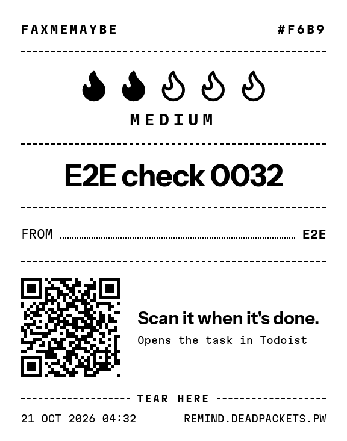
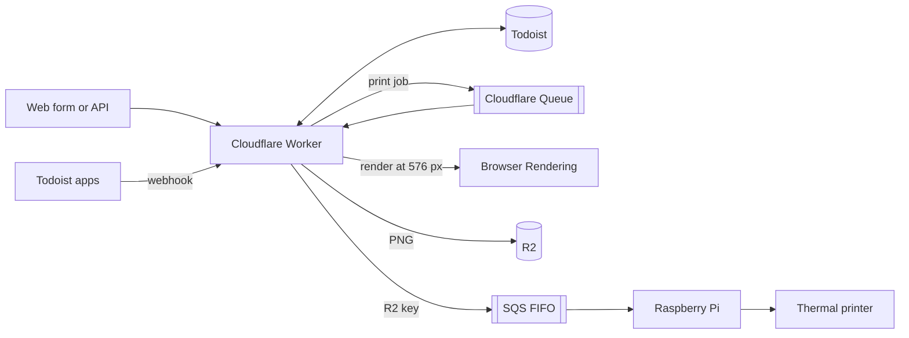

# FaxMeMaybe

[](https://remind.deadpackets.pw)
[](https://remind.deadpackets.pw/api/health)
[](LICENSE)

Send me a TODO at [remind.deadpackets.pw](https://remind.deadpackets.pw) and it prints on a thermal printer on my desk.

It is a reminder system that is over-engineered on purpose. The idea comes from Laurie Hérault's article [A thermal receipt printer cured my procrastination](https://www.laurieherault.com/articles/a-thermal-receipt-printer-cured-my-procrastination) and a [Coding With Lewis video](https://www.youtube.com/watch?v=xg45b8UXoZI). I built it to learn Cloudflare Workers, message queues, headless rendering and a little hardware in one silly project.



*A real ticket from the end-to-end test.*

## How it works



1. Someone fills in the form, or something calls `POST /api/todos`. My n8n email parser and a Linear automation both use the API.
2. The Worker creates the task in Todoist and replies. Todoist is my real task list, so I manage everything in its apps.
3. A print job goes on a Cloudflare Queue. The Worker's queue consumer opens `/todo-ticket` in Cloudflare's headless browser at 576 px (80 mm paper), takes a screenshot of the ticket and stores the PNG in R2.
4. It puts the R2 key on an SQS FIFO queue.
5. A Raspberry Pi polls the queue, downloads the PNG and prints it with python-escpos.
6. When the task is done, I scan the QR code on the ticket. It opens the task in the Todoist app, and I tick it off there.

Tasks that I add in the Todoist apps print too. Todoist webhooks tell the Worker when a task is added, completed or deleted. Every new task prints unless it has the `noprint` label, and the stats on the site count tickets printed, done and still on the desk.

## Repository layout

```
fax-me-maybe-server/          Cloudflare Worker (Hono) and the React app
  src/worker/index.ts         API, ticket rendering, Todoist webhook
  src/worker/services/        Todoist client
  src/react-app/App.tsx       The form
  src/react-app/Ticket.tsx    The ticket, used by the print render and the live preview
fax-me-maybe-client/          Raspberry Pi queue consumer (Docker image on GHCR)
e2e/ticket_e2e.py             End-to-end print check
PRODUCT.md                    Who the app is for and its design principles
VERSION                       Major.minor version; CI adds the build number
```

## Setup

### Worker

You need a Cloudflare account with Workers, D1, R2, Queues and Browser Rendering, a Todoist account and an AWS SQS FIFO queue.

```bash
cd fax-me-maybe-server
npm install
npx wrangler queues create faxmemaybe-print
npx wrangler d1 migrations apply faxmemaybe-db --remote
npx wrangler secret put TODOIST_API_TOKEN    # repeat for every secret below
npm run deploy
```

| Secret | Purpose |
|---|---|
| `TODOIST_API_TOKEN` | Todoist API token (Settings → Integrations → Developer) |
| `TODOIST_WEBHOOK_SECRET` | Client secret of your Todoist app, used to verify webhooks |
| `HONO_API_KEY` | Key for the admin endpoints and to skip the rate limit |
| `AWS_ACCESS_KEY_ID`, `AWS_SECRET_ACCESS_KEY`, `AWS_REGION` | Credentials that can send to the queue |
| `SQS_QUEUE_URL` | The FIFO queue URL |

`wrangler.json` also sets `TODOIST_PROJECT_NAME`, `TIMEZONE` (the time zone printed on tickets) and `VERSION` (set by CI). For local development, put the secrets in `.dev.vars` and run `npm run dev`.

### Todoist webhook

This makes tasks added in the Todoist apps print.

1. Create an app in the [Todoist App Console](https://developer.todoist.com/appconsole.html).
2. Set the webhook callback URL to `https://<your domain>/api/webhooks/todoist` and select the `item:added`, `item:completed` and `item:deleted` events.
3. Todoist sends webhooks only for accounts that authorized the app, so run the app's OAuth flow once with your own account.
4. Run `npx wrangler secret put TODOIST_WEBHOOK_SECRET` with the app's client secret.

### Raspberry Pi client

Run `ghcr.io/deadpackets/fax-me-maybe-client` with `fax-me-maybe-client/docker-compose.yml`. Its `.env` needs `SQS_QUEUE_URL`, `AWS_REGION`, `AWS_ACCESS_KEY_ID`, `AWS_SECRET_ACCESS_KEY` and `TICKETS_BUCKET_URL` (the public URL of the R2 bucket). The container needs USB access to the printer.

## API

`POST /api/todos` is public and allows 10 requests a minute per IP. Requests with a valid `X-API-KEY` header skip the limit.

| Field | Required | Notes |
|---|---|---|
| `todo` | Yes | Up to 64 characters |
| `importance` | Yes | 1 (low) to 5 (critical) |
| `description` | No | Up to 500 characters. Saved in Todoist, not printed |
| `dueDate` | No | Natural language, like `next friday at 2pm` |
| `from` | No | Up to 40 characters |
| `labels` | No | Names of existing Todoist labels |
| `source` | No | Free text, saved in the task description |

```bash
curl -X POST https://remind.deadpackets.pw/api/todos \
  -H "Content-Type: application/json" \
  -d '{"todo": "Review the new feature", "importance": 3, "dueDate": "tomorrow at 5pm", "from": "API User"}'
```

The response comes back when the task is saved in Todoist. The ticket prints from a Cloudflare Queue, which retries a failed print 3 times. A print that still fails shows only in the Worker logs.

Other endpoints:

- Public: `GET /api/todos/stats`, `GET /api/labels`, `GET /api/health`
- With `X-API-KEY`: `GET /api/todos`, `PATCH /api/todos/:id/incomplete`, `DELETE /api/todos/:id`
- `POST /api/first-bloods` prints a "First Blood" receipt for CTF events.

## Testing

The end-to-end check sends a real TODO through the whole pipeline and prints a real ticket. It checks that the PNG is exactly 576 px wide and that the QR code opens the Todoist task.

```bash
FAXMEMAYBE_API_KEY=... uv run e2e/ticket_e2e.py https://remind.deadpackets.pw
```

Run it against production. The queue consumer runs only on the deployed version, so a version preview URL can queue a ticket but never prints it.

It writes `ticket.png` and `report.json` to `e2e/artifacts/<timestamp>/`. With `FAXMEMAYBE_API_KEY` set, it deletes the test task afterwards.

## Credits

- Laurie Hérault, for the original idea
- Coding With Lewis, for the video that started this build
- [python-escpos](https://github.com/python-escpos/python-escpos), for the printer driver

MIT licensed. See [LICENSE](LICENSE).
